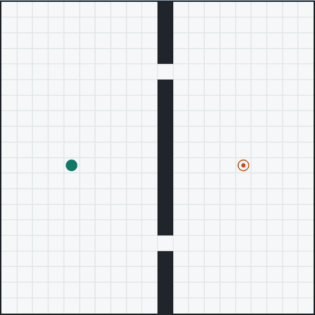
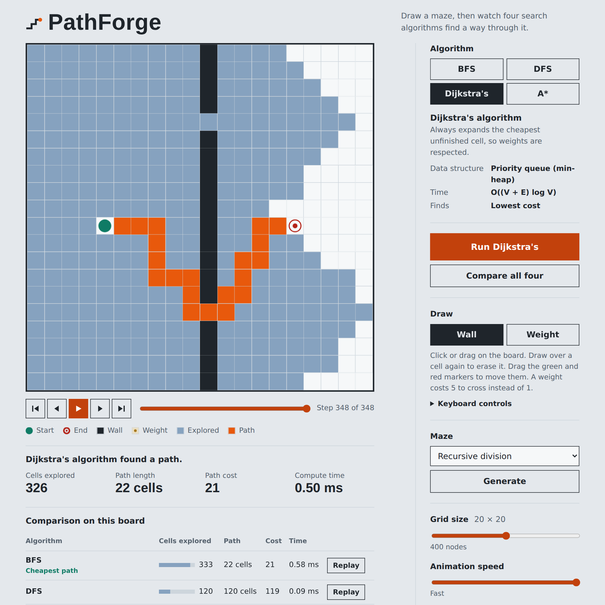
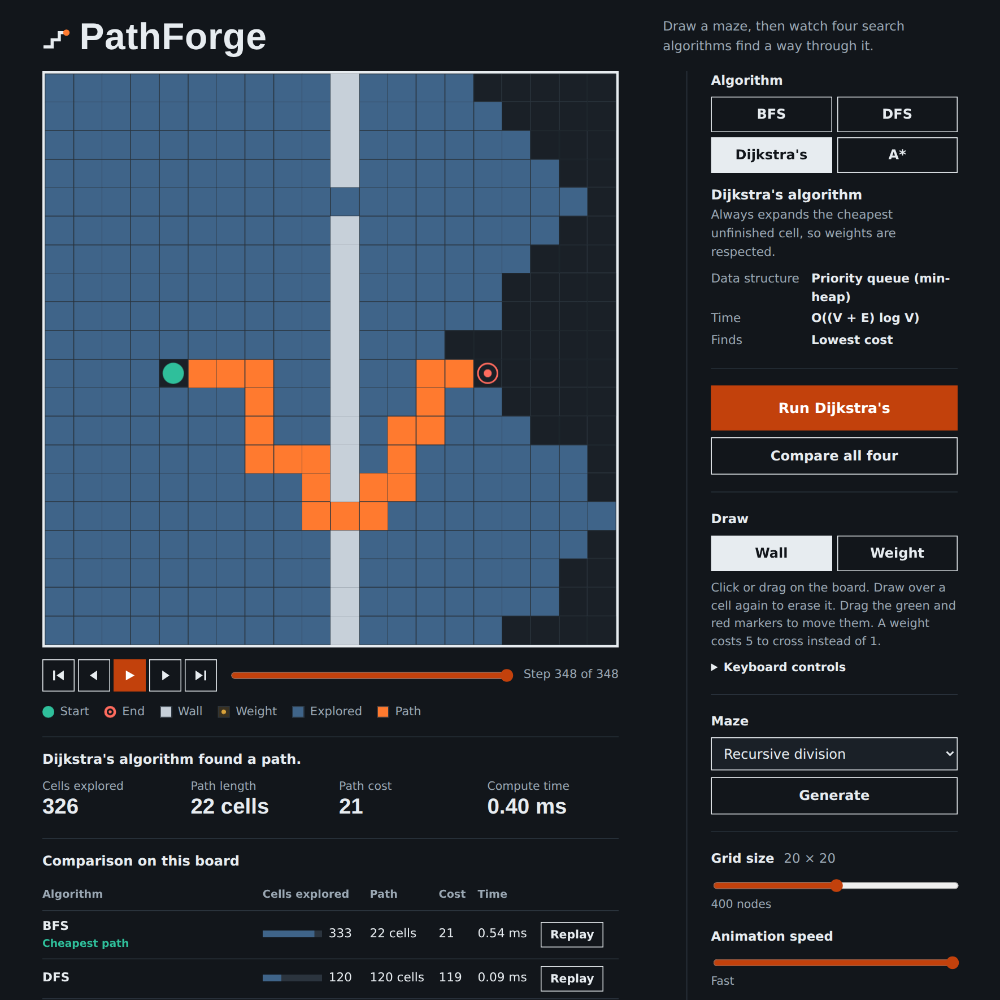

# PathForge

**An interactive graph algorithm visualizer.** Draw a maze, then watch BFS, DFS, Dijkstra's algorithm and A* search a grid, and scrub through every step of the search.

**Live demo:** https://mayank-d-tech.github.io/PathForge/



<p>
  
  
</p>

## Features

**Algorithms**
- Breadth-first search, depth-first search, Dijkstra's algorithm and A*, each visualized on a configurable grid (20 × 20 = 400 nodes by default, 10 × 10 up to 30 × 30).
- **Compare all four** runs every algorithm on your board and puts cells explored, path length, path cost and average run time side by side, with the best results highlighted. Replay any row with one click.

**Playback**
- Play, pause, step forward and back, restart, jump to the end, and **drag the timeline** to scrub through the search. Adjustable animation speed.
- Explored cells flash hot and cool to steel blue as the search spreads; the final path is drawn in molten orange.

**Building boards**
- Click or drag to draw walls; press on a wall to start erasing. Drag the start and end markers anywhere.
- **Weighted cells** cost 5 to cross instead of 1. Dijkstra's and A* route around them; BFS and DFS ignore them, which makes the difference easy to see.
- **Four maze generators**: recursive division, recursive backtracker, randomized Prim's, and random walls. The first three always produce mazes where every open cell is reachable.

**Quality of life**
- **Fully keyboard-drivable**: arrow keys move a cursor, Space draws, Shift + arrows draw while moving, `S` and `E` place the markers. The cursor position is announced to screen readers.
- Your board and settings are saved in the browser (validated on load, so corrupt data is ignored).
- Light and dark themes (follows your system), touch support, and `prefers-reduced-motion` is respected.

## How the algorithms compare

| Algorithm | Data structure | Time | Finds |
| --- | --- | --- | --- |
| BFS | Queue (FIFO) | O(V + E) | Fewest steps |
| DFS | Recursion (call stack) | O(V + E) | *A* path, not necessarily the shortest |
| Dijkstra's | Priority queue (binary min-heap) | O((V + E) log V) | Lowest cost, weights respected |
| A* | Priority queue + Manhattan heuristic | O((V + E) log V) | Lowest cost, usually exploring far fewer cells |

V is the number of open cells and E the number of connections between neighbouring cells. The grid is treated as an implicit graph: each open cell is a vertex, joined to its open neighbours above, below, left and right.

## Getting started

You need [Node.js](https://nodejs.org/) 18 or newer.

```bash
git clone https://github.com/mayank-d-tech/PathForge.git
cd PathForge
npm install
npm run dev
```

Open the local URL that Vite prints (usually http://localhost:5173).

| Command | What it does |
| --- | --- |
| `npm run dev` | Start the dev server with hot reload |
| `npm run build` | Create a production build in `dist/` |
| `npm run preview` | Serve the production build locally |
| `npm test` | Run the test suite (Node's built-in test runner, no extra dependencies) |

## Keyboard controls

Tab to the board, then:

| Key | Action |
| --- | --- |
| Arrow keys | Move the cursor |
| Space / Enter | Draw or erase with the selected tool |
| Shift + arrows | Draw while moving |
| `S` / `E` | Put the start / end marker on the cursor |
| Delete | Erase the cell under the cursor |

## Project structure

```
src/
├── algorithms/          # Pure JavaScript, no React: easy to test
│   ├── bfs.js           # queue
│   ├── dfs.js           # recursion
│   ├── dijkstra.js      # min-heap
│   ├── astar.js         # min-heap + heuristic
│   ├── minHeap.js       # binary heap used as the priority queue
│   ├── mazes.js         # four maze generators + marker snapping
│   ├── board.js         # empty / demo boards, default markers, size limits
│   ├── utils.js         # neighbours, path rebuilding, costs
│   └── index.js         # algorithm registry used by the UI
├── lib/
│   ├── compare.js       # run all algorithms and highlight the best results
│   └── storage.js       # save / load / validate the board in localStorage
├── hooks/
│   └── usePlayback.js   # replay engine: play, pause, step, scrub
├── components/
│   ├── Board.jsx        # grid, pointer input, keyboard focus
│   ├── Transport.jsx    # playback buttons and timeline
│   ├── Controls.jsx     # algorithm picker, tools, mazes, sliders
│   ├── RunReport.jsx    # status line and run statistics
│   └── ComparisonTable.jsx
├── App.jsx              # state and wiring
└── index.css            # design tokens, light and dark themes
tests/                   # node:test suites for algorithms, mazes, storage, comparison
```

## How it works

Every algorithm is a pure function `(grid, start, end) => { visited, path, found }`. It returns the cells it explored **in order**, plus the final path. The search itself runs instantly; the UI then **replays** the result.

Playback is just a counter. Frames `0 … explored - 1` reveal explored cells and the remaining frames reveal the path, so a cell is drawn as explored once the counter passes its position in `visited`. Because the whole run is a single number, pause, single-step and scrubbing come for free, and the animation speed can never change what an algorithm does. Cells are memoised, so only the cells that change are re-rendered on each frame.

A few implementation details worth knowing:
- BFS dequeues in O(1) with an array and a head pointer instead of `Array#shift`.
- Dijkstra's and A* use a hand-written binary heap with lazy deletion instead of a decrease-key operation.
- A* breaks ties on the heuristic, and its Manhattan heuristic never overestimates on a 4-connected grid, so its paths are optimal.
- The perfect-maze generators work on a lattice of even-indexed cells so passages can never be blocked by a later wall.

## Testing

`npm test` runs the suite with Node's built-in test runner. It checks, among other things, that:

- the heap always pops in sorted order,
- BFS, Dijkstra's and A* return a shortest path on an open board,
- Dijkstra's and A* agree on path cost across 300 random weighted boards,
- Dijkstra's and A* detour around expensive cells while BFS does not,
- every algorithm reports "no path" when the end is walled in,
- DFS survives a long snaking path on the largest board,
- every maze generator produces fully connected mazes for every grid size from 10 to 30,
- saved boards round-trip, and corrupt or tampered saved data is rejected,
- the comparison and its highlights are correct.

## Deploying to GitHub Pages

This repo includes a workflow that tests, builds and publishes the site on every push to `main`.

1. Push the project to a GitHub repository named `PathForge`.
2. In the repository go to **Settings → Pages** and set **Source** to **GitHub Actions**.
3. Push to `main`, or run the workflow from the **Actions** tab. The site appears at `https://<your-username>.github.io/PathForge/`.

A second workflow runs the tests and a build on every pull request.

## Ideas for next steps

- Bidirectional search and greedy best-first search
- Diagonal movement with a choice of heuristics
- Animated maze generation
- Shareable links that encode a board in the URL

## License

[MIT](LICENSE)
